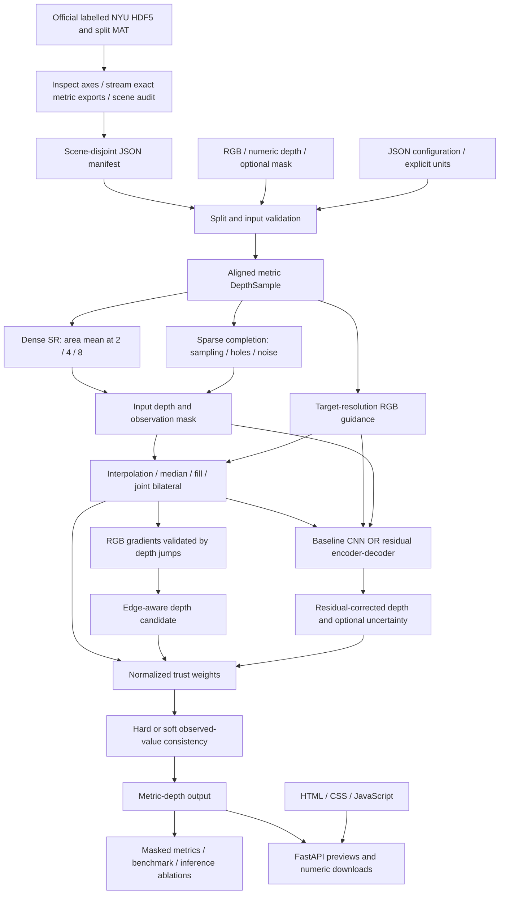

# Implemented architecture

The API permits classical methods without PyTorch. Deep/hybrid calls require a
trained checkpoint and fail explicitly otherwise. The CNN and fusion paths have
been tested structurally; they are not yet a trained reconstruction system.
The diagram shows implemented interfaces, not measured improvement.

The custom network uses 8 input channels: RGB (3), initial classical depth (1),
observed validity (1), scale/8 (1), sparse-mode indicator (1), RGB-present flag (1).
Encoder channels are 32/64/128; decoder channels 64/32, with interpolation and
skip connections supporting odd target sizes. Outputs are residual, clamped
Laplace log scale and optional sigmoid boundary confidence. Fusion currently
uses deterministic geometric boundary confidence, not the optional learned
boundary head. A separate three-layer 32-channel CNN is the named lightweight
baseline. Neither model is described as DKN/FDKN.
