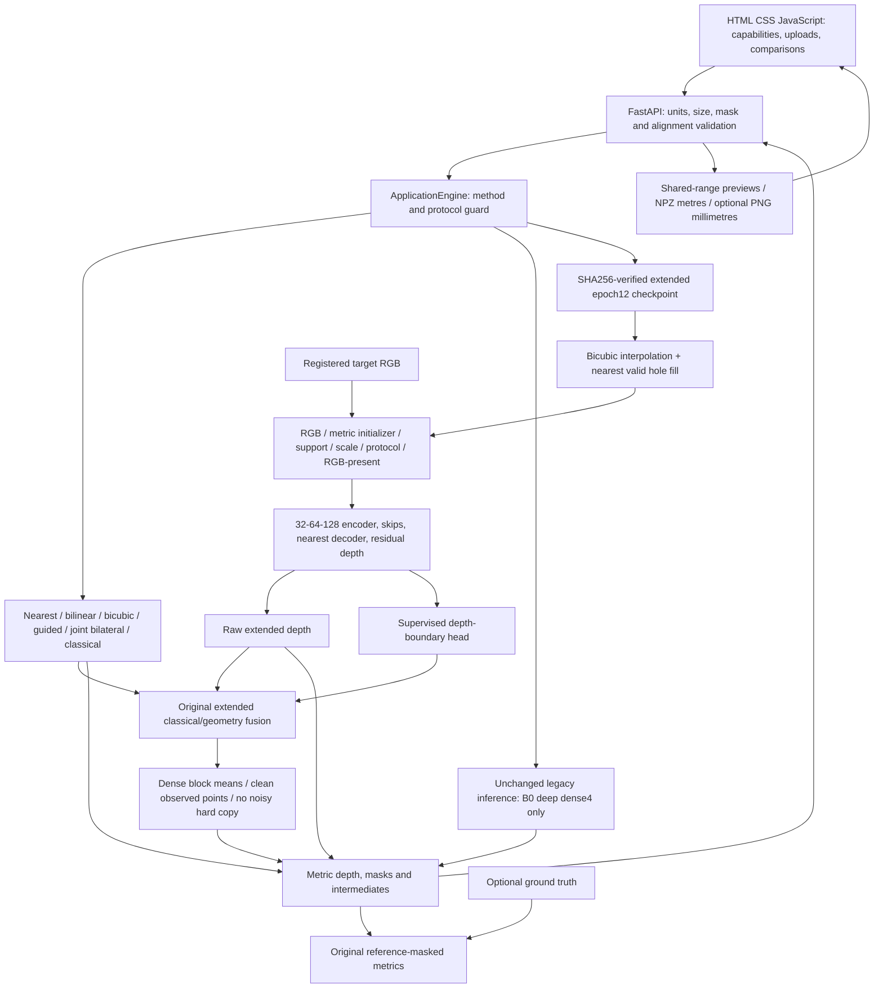

# Implemented application and model architecture

Dense SR: 2x/4x/8x. Completion: unchanged target grid, canonical learned conditioning scale 4.
The unused extended uncertainty head is frozen, not used as confidence. Geometry support and
boundary supervision mitigate texture artifacts but do not prove their absence. The app does not
run training or access any dataset split. Learned functionality requires an actual configured
checkpoint. Exact epoch-12 app inference has passed local synthetic HTTP/browser checks;
public Modal HTTP/browser checks passed. Final independent scientific benchmark results remain pending.

Training/data/benchmark code is preserved byte-for-byte during this application phase so the
externally running Colab benchmark and checkpoint source identity remain intact.
