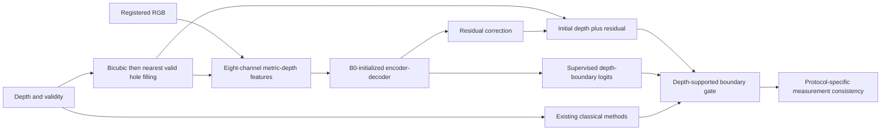

# Extended TRIDENT v1: implementation and training contract

This is a separate experiment, not a replacement for A1, B0 or
`hybrid_v1_dense4`. The reported completed hybrid run remains at
`verification_results/hybrid_v1_dense4/20261107T030059Z_661a037994` on Drive;
it is not present locally and has not been independently re-audited here.
No completed experiment is rerun by this workflow.

## Architecture and reuse

`trident_depth/extended_v1/model.py` uses B0's 32/64/128-channel residual
encoder-decoder, nearest decoder interpolation and eight input channels:
RGB, metric initial depth, observed support, scale/8, completion indicator,
and RGB-presence indicator. There are 473,059 stored parameters; the 33
unused uncertainty-head parameters are frozen (473,026 trainable).
The new model identity is `trident_extended_v1`. Legacy registries, forward
guards, checkpoint loaders and all old configuration files are unchanged.

Fresh construction retains exact-zero residual initialization, but the real
run strictly transfers **all** verified B0 tensors, including its trained
residual head. It does not zero or retrain the original B0 checkpoint.
The original uncertainty head is retained solely for tensor compatibility;
it has no forward graph, optimizer parameters or loss. Boundary logits are
now supervised. No uncertainty calibration claim is made.



## Data and protocol identity

The original `manifest_development.json` SHA256 must be
`d1cdbcf0ff3ee96f2e0c173c3c4701ed3f5c526ab517ce3b988268c3c6a391f5`.
There are 672 training frames from 219 scenes and 123 validation frames
from 30 different scenes. The official test scene labels are checked for
disjointness in shared metadata only; test sample paths are never resolved,
statted or opened. The new Colab archive has **only 795 development frames**
(2,385 RGB/depth/mask payloads), not the old full NYU archive. Validation
IDs, order, payload hashes and target masks match the original pilot reference.
All input/target depths and losses use metres; RGB is divided by 255.
There is no image-dependent depth normalization or inverse-depth transform.

| Task | Actual spatial factor | Input construction |
| --- | --- | --- |
| dense2 | 2 | Original non-overlapping 2x2 area means |
| dense4 | 4 | Original non-overlapping 4x4 area means |
| dense8 | 8 | Original non-overlapping 8x8 area means |
| sparse | 1 | Random 5% clean target-grid observations |
| noisy | 1 | Target-grid dense observations, Gaussian sigma 0.01 m |
| incomplete | 1 | Target-grid clean observations, central 25%-area hole |
| sparse_noisy_holes | 1 | 5% observations, sigma 0.01 m, 25%-area hole |

Completion uses the existing canonical scale-conditioning value 4, while
its **spatial factor is 1**. It must never be reported as 4x upsampling.
These are synthetic degradations of real NYU inpainted references, not
claims about raw sensor completion, KITTI or arbitrary noise distributions.
Random/grid sampling remains available in the reused degradation function;
the initial training contract uses random sampling. Empty observations
are rejected rather than fabricated. Missing RGB is supported by inference
feature packing; this first NYU training contract uses registered RGB.

Training visits every training frame exactly once per epoch. Task assignment
`(original_frame_index + epoch - 1) % 7` gives 96 frames per task per epoch
and rotates conditions across scenes. There are 672 optimizer steps per
epoch, not 672 per task. Training degradation seeds are
`69 + 1009*(epoch-1)`; validation seeds stay 69. No validation image enters
the shuffled training loader. Validation evaluates all 123 frames under
each of seven fixed protocols (861 protocol/frame pairs) after every epoch.

## Loss and texture protection

The new objective is

`L = L_depth + 0.2 L_gradient + 0.1 L_edge + 0.2 L_measurement
     + 0.01 L_boundary + 0.02 L_false_edge`.

Depth/gradient/edge terms reuse existing masked implementations. The depth
edge weight is based on valid GT differences of at least 0.05 m. Dense
measurement loss compares predicted block means at the actual scale with
LR measurements. Completion compares only observed target-grid points;
its measurement term is multiplied by 0.25 when observations are noisy.
No hard consistency is applied to noisy observations.

Boundary targets mark both endpoints of valid GT depth differences >=0.05 m.
A 3x3 invalid-neighbour exclusion avoids labeling missing pixels as edges.
The boundary head uses masked BCE-with-logits; RGB edges are never labels.
The false-edge term penalizes excess predicted absolute gradients over GT
gradients where the valid GT gradient is <0.01 m. Loss reductions are FP32,
and invalid target NaNs are excluded before arithmetic. These new weights
are an initial experimental choice, not established optimal values.

`inference.py` reuses interpolation, hole filling, joint bilateral/guided
filtering and geometric boundary refinement. A classical/geometry correction
requires a depth discontinuity as well as the supervised head score. An
RGB-only edge cannot open this fusion gate. The blend is
`N + gate * (0.15*(C-N) + 0.15*(G-N))` followed by consistency:
bounded block-mean projection for clean dense SR, exact observed-point
retention for clean completion, and no hard copy for noisy completion.
The gate is a boundary heuristic, not calibrated reconstruction confidence.
The learned branch can still make false edges: losses and synthetic tests
do not prove absence of texture copying on real validation examples.

## Training, validation and recovery

`configs/extended_v1/train.json` is a new, explicit 12-epoch budget: Adam,
LR 1e-4, zero weight decay, batch 1, constant LR, gradient norm limit 5,
seed 69, full 480x640 NYU frames, no patch-based validation. Best checkpoint
selection minimizes the equally weighted mean of the seven task-specific
global pixel-weighted RMSEs. This is not dense4-only model selection.
Each task also records MAE, global PSNR (10 m range), mean-frame SSIM and
mean-frame boundary F1 using existing metric implementations and masks.
Runtime, task counts, loss components and allocated/reserved GPU peaks
are recorded each epoch. Hybrid quality and independently repeated
inference latency still require a subsequent validation benchmark.

FP32 is intentional: the existing B0 reference is FP32 and no T4 AMP
stability experiment has qualified these losses. Batch 1 avoids relying
on an unmeasured memory estimate. The notebook's full-resolution seven-task
T4 forward/backward preflight records actual memory without optimizer
steps. It also prints a rough runtime projection from measured preflight
speed, explicitly an estimate rather than a training result. Full training
is blocked if this exact code/config/data/environment has not passed.

Checkpoints store strict model state, Adam moments, constant scheduler,
disabled scaler state, Python/NumPy/Torch/CUDA/loader RNG, complete history,
best epoch/score and source/config/data/environment provenance. Resume is
at complete epoch boundaries, with the same source, config, dataset and
package versions. A disconnected partial epoch is replayed from the last
complete checkpoint. No epoch checkpoint is overwritten. New run directories
must contain `extended_v1`; the runner refuses legacy model files. There is
no automatic extra training after epoch 12, no export and no test evaluation.

## Files and local commands

The `extended_v1` package contains `model.py`, `data.py`, `loss.py`,
`checkpoint.py`, `contract.py`, `preflight.py`, `train.py` and `inference.py`.
`tests/test_extended_v1.py` covers protocols, gradient flow, masks, texture
gating, consistency, strict serialization, epoch-state resume and isolation.
`scripts/pack_extended_v1_data.py` builds a new development-only archive.

PowerShell (repository root):

```powershell
$env:PYTHONDONTWRITEBYTECODE='1'
.venv\Scripts\python.exe -B -m pytest -q -p no:cacheprovider
.venv\Scripts\python.exe -B -m trident_depth.extended_v1.preflight --config configs/extended_v1/train.json --manifest data/nyu/converted/manifest_development.json --checkpoint artifacts/colab/hybrid_v1_dense4_execution_20261107/B0_epoch_002.pt --device cpu --output artifacts/extended_v1/NEW_cpu_preflight.json
```

The Colab notebook supplies the exact verified GPU preflight and training
commands, fresh Drive directories and an explicit same-run resume option.
It uses the existing Colab Python/CUDA PyTorch, never a Windows path or CPU
torch replacement. Setup runs the full suite before qualifying training.

## Mandatory P4 coverage and remaining evidence

The official PDF P4 (pages 8–9) requires interpolation, noise reduction,
hole filling, guided/joint bilateral filtering, depth discontinuities,
RGB guidance, learned adaptation, hybrid reconstruction, scales 2/4/8,
sparse/noisy/incomplete inputs, comparisons, unseen inputs, boundary
evaluation, latency/memory and a deployed application.

This phase implements the extended learned/training/hybrid path for those
input protocols. Existing classical implementations are reused; they are
not silently replaced. Model training, measured improvement on these new
protocols, all-method comparisons, ablations, real texture/failure-case
analysis, external-dataset generalization and deployment remain separate
evidence gates. None is marked complete by code existence. The official
test set stays locked. The application integration and final documentation
requirements remain mandatory later work; no old evaluation file is changed.
